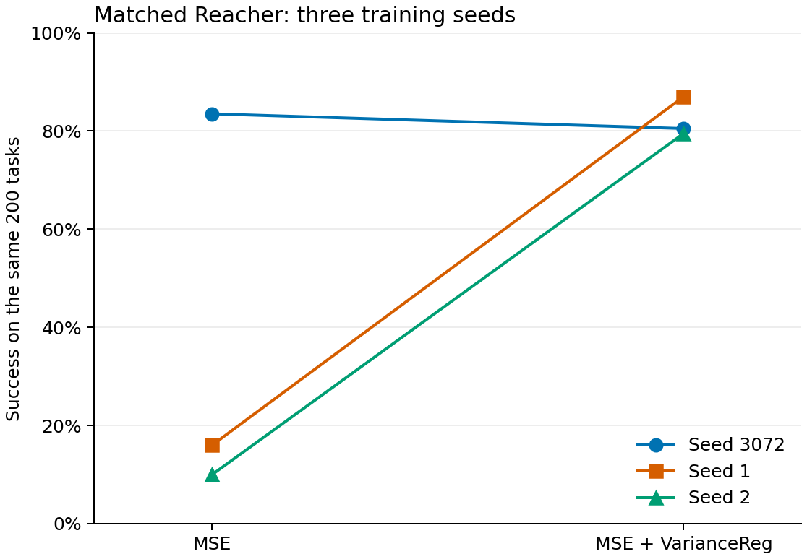

# E4 matched Reacher results

All six fresh trainings and evaluations completed under [protocol v2](../protocol.json).
Each used 10 epochs (the full LR horizon), 127,960 optimizer steps and an explicit
epoch-10 checkpoint. The arms share inverse-MSE weight 1 and SIGReg weight 0;
the variance arm adds `0.05 × VarianceReg(gamma=0.1)` to the same model and losses.

| Training seed | MSE | MSE + variance | Difference (percentage points) |
| --- | ---: | ---: | ---: |
| 3072 | 167/200 (83.5%) | 161/200 (80.5%) | -3.0 |
| 1 | 32/200 (16.0%) | 174/200 (87.0%) | +71.0 |
| 2 | 20/200 (10.0%) | 159/200 (79.5%) | +69.5 |

Across the three training seeds, success mean ± sample SD is
36.50% ± 40.81 percentage points for MSE and
82.33% ± 4.07 points for variance.
The paired difference is +45.83 ± 42.30 points.
These are descriptive seed statistics (SD uses `ddof=1`). The 200 shared tasks
are not independent training repetitions. Three seeds and one evaluation seed
do not establish general superiority or a robust rescue.

Final validation representation diagnostics remain continuous:

| Run | Embedding std | Effective rank | Inverse margin |
| --- | ---: | ---: | ---: |
| mse_s3072 | 0.0736040 | 5.0812 | +0.1645066 |
| variance_s3072 | 0.1067483 | 5.6026 | +0.1645138 |
| mse_s1 | 0.0006578 | 10.4249 | -0.0026479 |
| variance_s1 | 0.1267317 | 3.4963 | +0.1643209 |
| mse_s2 | 0.0004096 | 5.7949 | -0.0025718 |
| variance_s2 | 0.1378161 | 3.5035 | +0.1641533 |

No binary collapse threshold was introduced. [results.json](results.json) retains
all ten validation epochs, scalar diagnostic ranges, gradient-norm summaries,
1,200 raw success booleans, six frozen train/eval configs, paired initialization
and split/RNG hashes, checkpoint hashes, and all 84 artifact hashes.
Its variance-loss diagnostics are unweighted; the objective multiplies them by 0.05.

[tasks.json](tasks.json) contains the 200 actual consumed start/goal endpoints,
including trajectory IDs, episode IDs, step indices and qpos. Every outcomes
array follows this order. All six task lists matched and passed direct checks
against the canonical HDF5. Evaluation used seed 42, batches of 10, goal offset
25, budget 50 and CEM 300 samples / 30 steps / 30 elites. Each final checkpoint
was independently downloaded, hashed and loaded on CPU to check finite tensors.

Execution source: `0c50bf09d4835b8d69c7f9febd62820f72348ba1`. All runs shared A100-SXM4-40GB,
eight CPUs, 32 GiB RAM and eight loader workers with prefetch factor two.
[packages.txt](packages.txt) and the source/runtime/data hashes in results.json
record the runtime. Full logs, checkpoints and diagnostics remain on Modal volume
`multi-future-lewm-cache` under `e4/e4-v2/<run>/`.

The two v1 attempts stopped incomplete at 600 and 500 logged steps because their
two-worker loader runtime could not meet the compute cap. They produced no final
checkpoint or evaluation and were not reused. Their 733 allocated GPU-seconds
remain charged. Total conservative allocation was **43.579722 GPUh / 60 GPUh**,
excluding queue time and counting reused containers once. Maximum simultaneous
GPU containers was two; all four distinct containers ended. V2 output plus the
334,518-byte retained v1 evidence totaled 504,992,348 bytes at the final owner
archive, below 6 GiB.

The CPU supervisor was lost after dispatching all six calls; its status remains
stale at four completions. All six original worker calls returned successfully.
Direct owner reconciliation verified their results and final provider allocation,
without restarting a worker. This failure and both incomplete v1 attempts remain
in results.json. The separate canonical owner receipt is
`e4/e4-v2/owner-reconciliation/final-20261108/owner-final-reconciliation.json`.
