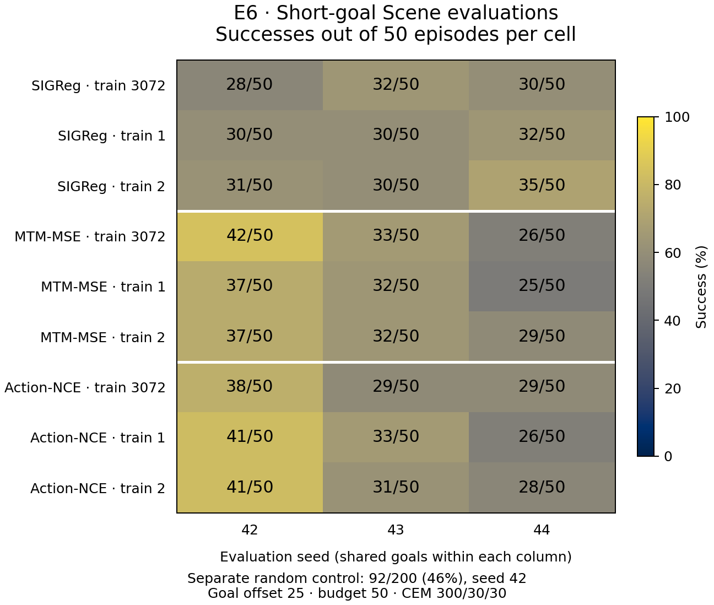

# E6 results: short-goal evaluation variability

All 27 planned model evaluations and the seeded random control completed on
2026-11-07. These are fresh matched evaluations of the nine original Scene
epoch-10 checkpoints under the [frozen SHORT protocol](../README.md), not a
rerun of the 100-offset/100-budget study or a replacement for archived headlines.
Nominal goal offset 25 selects row `start + 24`; the interaction budget is 50,
CEM is 300/30/30, and environment batches contain ten episodes.

## Every accepted result

Each model cell contains 50 episodes. The final column describes variation
across the three evaluation seeds for one fixed trained checkpoint; SD is the
sample standard deviation in percentage points (`n = 3`).

| Method | Training seed | Eval 42 | Eval 43 | Eval 44 | Across eval seeds: mean ± SD (%) |
|---|---:|---:|---:|---:|---:|
| SIGReg | 3072 | 28/50 | 32/50 | 30/50 | 60.00 ± 4.00 |
| SIGReg | 1 | 30/50 | 30/50 | 32/50 | 61.33 ± 2.31 |
| SIGReg | 2 | 31/50 | 30/50 | 35/50 | 64.00 ± 5.29 |
| MTM-MSE | 3072 | 42/50 | 33/50 | 26/50 | 67.33 ± 16.04 |
| MTM-MSE | 1 | 37/50 | 32/50 | 25/50 | 62.67 ± 12.06 |
| MTM-MSE | 2 | 37/50 | 32/50 | 29/50 | 65.33 ± 8.08 |
| Action-NCE | 3072 | 38/50 | 29/50 | 29/50 | 64.00 ± 10.39 |
| Action-NCE | 1 | 41/50 | 33/50 | 26/50 | 66.67 ± 15.01 |
| Action-NCE | 2 | 41/50 | 31/50 | 28/50 | 66.67 ± 13.61 |

The random control achieved **92/200 (46%)**, evaluation/action seed 42. Its
200 goals were sampled separately from the models' 50-goal sample; it is not a
paired control for those 50 episodes. Actions use seed `42 + batch_start`,
set before policy attachment. One random seed does not estimate seed variance.



## Variation across training seeds

Each entry is mean success (%) ± sample SD (percentage points) across training
seeds 3072, 1 and 2 at a fixed evaluation seed (`n = 3`).

| Method | Eval 42 | Eval 43 | Eval 44 |
|---|---:|---:|---:|
| SIGReg | 59.33 ± 3.06 | 61.33 ± 2.31 | 64.67 ± 5.03 |
| MTM-MSE | 77.33 ± 5.77 | 64.67 ± 1.15 | 53.33 ± 4.16 |
| Action-NCE | 80.00 ± 3.46 | 62.00 ± 4.00 | 55.33 ± 3.06 |

The ordering of these means changes with the evaluation seed: Action-NCE is
highest at 42, MTM-MSE at 43, and SIGReg at 44. These descriptive results do not
establish a consistent advantage or statistical significance. Models share
the same start/goal IDs within an evaluation seed; shared episodes are not
independent training repetitions. The two seed axes above must not be pooled
into 27 independent trained models or 1,350 independent training repetitions.

## Provenance and incomplete work

[manifest.json](manifest.json) maps every accepted cell to its original
checkpoint, source commit, Modal app/call/worker IDs, commands, runtime and file
hashes. The first four cells (SIGReg's three training seeds and MTM-MSE training
seed 3072, all at eval seed 42) retain their original `ce2cba6` source and v3
provenance byte for byte. The other 24 use `2e331f8` in v4. The evaluator,
model code and E6 runner hashes match across those sources; orchestration differs.
No accepted cell was repeated or selected by score.

One v3 evaluation of MTM-MSE training seed 1/eval seed 42 was interrupted after
three complete ten-episode batches: **9/10, 7/10, 8/10**. Its complete episode
vector and final exit status were never written. The manifest retains these
raw batch progress lines, the log hash and original task/source identity;
[incomplete/runtime.json](incomplete/runtime.json) preserves its original
startup record. These partial observations are separate from the accepted
37/50 v4 result and are not extra independent samples. The interruption and
restart failure, not the score, required a fresh evaluation after reconciliation.
Earlier attempts produced no accepted outcomes; their dispositions are recorded
in the manifest. Full failure and session logs remain in the experiment archive.

All accepted cells used NVIDIA L4 GPUs and Python 3.10.17 with identical
[package snapshots](packages.txt). NVIDIA-SMI reports driver 610.57.04 and
CUDA compatibility 13.3; this is not the PyTorch build's CUDA version. Per-cell `gpu.txt`
and `runtime.json` retain hardware, provider and environment details: 25 cells
ran on GCP and three on AWS. This fresh Modal environment differs from the
archived environment, which limits direct historical comparisons. Local GPUs
remained occupied by existing paper studies; Modal supplied bounded capacity.

The final worker finished at 22:52:03.759 UTC, before the unchanged
23:10:09.874 UTC deadline. Accepted worker time totals 14,606.120 seconds;
including the 1,800-second prior reserve gives **4.5573 GPU-hours accounted**
against the 12-hour cap. This is conservative budget accounting, not a billing
measurement. At most two L4 workers ran concurrently; no job exceeded two hours.

## Audit and reuse

Each cell publishes original `outcomes.txt`, `tasks.json` (resolved evaluation
config, start/goal rows, episode IDs, success vector), `runtime.json`, and
`gpu.txt` bytes. All 28 identical package files are stored once and referenced
by hash. The [protocol](../protocol.json) supplies dataset, checkpoint and
training-config hashes, all 19 of which passed local/remote identity checks.
Task IDs also matched an independent reconstruction from the shared HDF5 file.
The manifest includes hashes of those four independently computed task sets
and the retained per-cell evaluation logs. Raw files keep original paths.

From the repository root, without GPUs, checkpoints or dataset downloads:

```bash
python3 -m experiments.e6.check_integrity
python3 -m experiments.e6.summarize experiments/e6/results
```

The check verifies published file hashes, frozen job/config identity, raw-text
and JSON outcomes, matched task IDs, source/runtime provenance, budget/deadline,
and both seed summaries. [summary.json](summary.json) contains unrounded values.
The recorded source hashes were checked against their exact Git commits before
publication; the offline check compares them with the manifest's source map.
